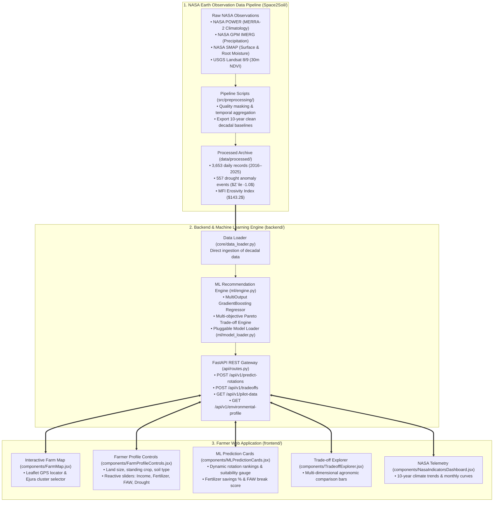

# AgroHelp System Architecture & Repository Blueprint

This document explains the structural layout, system components, data contracts, and cross-functional responsibilities across the **AgroHelp** project.

---

## 1. High-Level System Architecture



---

## 2. Directory Layout & Functional Ownership

The repository is structured into four distinct, self-contained functional pillars:

```text
AgroHelp/
│
├── Space2Soil/               <- LAYER 1: NASA Data Science & Earth Observation Pipeline
│   ├── data/                 <- 10-Year Decadal Archive (Raw, Processed, Metadata)
│   ├── src/                  <- Acquisition, preprocessing, analysis & validation scripts
│   ├── notebooks/            <- Exploratory Jupyter notebooks (Phases 2, 3, 4)
│   ├── web/                  <- Standalone lightweight cockpit & visualizer
│   └── app.py                <- Zero-dependency HTTP gateway for standalone mode
│
├── backend/                  <- LAYER 2: Application Backend & Machine Learning Engine
│   ├── app/
│   │   ├── api/              <- FastAPI REST routers & endpoint definitions
│   │   ├── core/             <- Configuration, settings & decadal data loader
│   │   ├── ml/               <- GradientBoosting ML engine, crop biology & model loaders
│   │   └── schemas/          <- Pydantic validation schemas for requests & responses
│   └── tests/                <- Pytest test suite (17/17 tests passing)
│
├── frontend/                 <- LAYER 3: Farmer Decision-Support Web Dashboard
│   ├── src/
│   │   ├── components/       <- React UI: Map, priority sliders, ML cards, tradeoff explorer
│   │   ├── services/         <- Resilient API client with fallback simulation
│   │   └── assets/           <- GeoJSON boundaries, icons, and styling
│   └── package.json          <- React 18, Vite, Tailwind CSS, Leaflet, Lucide
│
├── docs/                     <- LAYER 4: Central Knowledge Base & Technical Documentation
│   ├── README.md             <- Master documentation index
│   ├── 01_mofa_ejura_context.md       <- Ministry of Food & Agriculture local reality
│   ├── 02_nasa_earth_observation.md   <- Satellite specifications & scale caveats
│   ├── 03_scientific_methodology.md   <- Agro-meteorological models & mathematical formulas
│   ├── 04_ml_recommendation_engine.md <- ML model architecture & tradeoff calculations
│   ├── 05_api_reference.md           <- REST endpoint contracts & payload schemas
│   └── 06_competition_pitch_guide.md  <- 3-minute challenge pitch script & slides
│
├── scripts/                  <- LAYER 5: 1-Click Developer Productivity Suite
│   ├── dev-backend.bat / .ps1         <- Launch FastAPI backend server
│   ├── dev-frontend.bat / .ps1        <- Launch React Vite development server
│   ├── dev-space2soil.bat / .ps1      <- Launch Space2Soil standalone cockpit
│   └── run-all-tests.ps1              <- Run all 27 automated tests across subsystems
│
├── Info/                     <- Original problem roadmap & hackathon challenge notes
├── .env.example              <- Environment configuration template
├── .gitignore                <- Comprehensive repository ignore rules
└── README.md                 <- Master project overview & quickstart guide
```

---

## 3. Communication & Data Flow

1. **Space2Soil $\rightarrow$ Backend**:
   - `backend/app/core/data_loader.py` reads clean decadal CSVs directly from `Space2Soil/data/processed/`.
   - Ingests 3,653 daily climate records, 3,653 daily rainfall records, 3,653 daily soil moisture records, and 557 drought events into memory.
2. **Backend $\rightarrow$ Machine Learning Engine**:
   - `backend/app/ml/engine.py` extracts agro-meteorological features from the loaded decadal baseline and combines them with farmer priorities.
   - Evaluates rotation candidates dynamically using `MultiOutputRegressor(GradientBoostingRegressor)` or hot-loads any `.joblib` model provided by the data science collaborator in `Space2Soil/`.
3. **Backend $\rightarrow$ Frontend**:
   - FastAPI serves REST endpoints on port `8000` with full CORS support.
   - `frontend/src/services/api.js` queries `/api/v1/predict-rotations` with farmer inputs, updating recommendations and trade-offs in real time.
