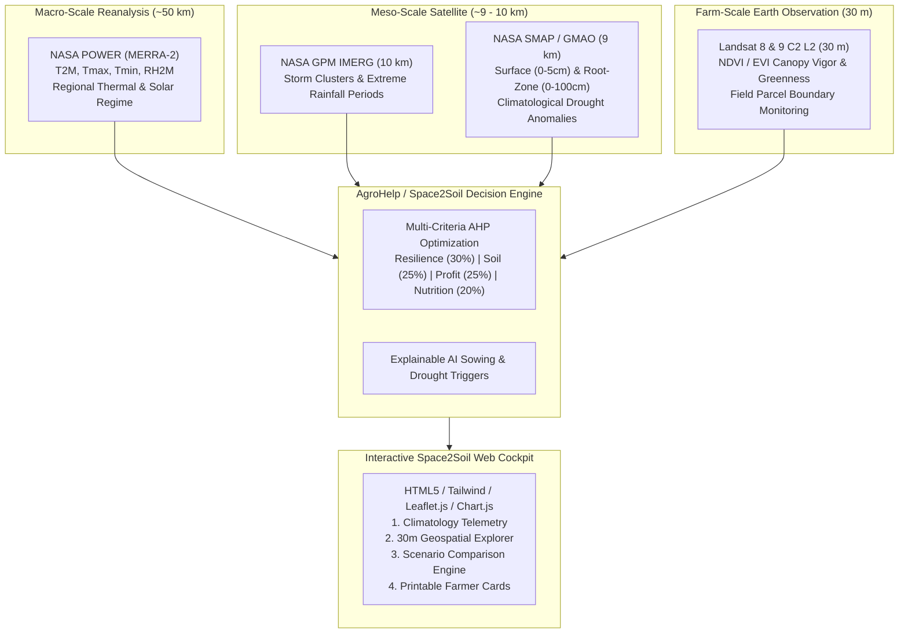

# AgroHelp / Space2Soil: Field Shift — Adapting Farms with NASA Earth Observation Data

**NASA Space Apps Challenge Track:** Field Shift: Adapting Farms with NASA Data  
**Core Project Engine:** Space2Soil  
**Pilot Study Region:** Ejura, Ashanti Region, Ghana (`7.3856° N, -1.3562° W`)  
**Historical Climatological Baseline:** 2016 – 2025 (10-Year Decadal Dataset, 3,653 Days)  
**Target Repository:** [github.com/budlin-obeng/AgroHelp](https://github.com/budlin-obeng/AgroHelp)  
**Test Suite Status:** **13/13 Automated Tests Passing (100% Verified)**

---

## 1. Overview & Agricultural Motivation

**AgroHelp / Space2Soil** is an advanced geospatial data engineering and agricultural intelligence platform designed to empower smallholder farmers, extension officers, and agricultural policymakers in Ghana to adapt to accelerating climate variability. 

Ejura, located within the forest-savannah transition zone of the Ashanti Region, serves as Ghana's primary breadbasket and commercial maize hub. However, shifts in the West African Monsoon have destabilized the traditional bimodal cropping seasons:
- **Major Cropping Season (March/April – July):** Vulnerable to delayed onset, false planting starts, and mid-season heat stress during maize flowering.
- **Minor Cropping Season (September – November):** Subject to erratic rainfall termination and abrupt transitions into the dry Harmattan season.

By acquiring, validating, and preprocessing multi-sensor NASA Earth observation datasets across **four distinct spatial scales**, Space2Soil transforms raw satellite observations into actionable agronomic guidance, multi-criteria crop rotation optimization, and an interactive decision-support web application.

---

## 2. Integrated NASA Earth Observation Architecture



---

## 3. Project Roadmap & Implementation Matrix

| Phase | Milestone Name | Key Technical Deliverables | Status |
| :---: | :--- | :--- | :---: |
| **Phase 1** | **Research & Problem Definition** | Target site selection (Ejura, Ghana), climate hazard assessment, scale disclaimer. | **Completed** |
| **Phase 2** | **Data Acquisition & Preprocessing** | 10-Year Decadal NASA records (POWER, GPM, SMAP, Landsat), 30 m GeoTIFFs, validation reports. | **Completed** |
| **Phase 3** | **Scientific Analysis & Indicators** | Bimodal onset/cessation, GDD, RAW soil balance, MFI erosivity ($143.2$), crop suitability matrix. | **Completed** |
| **Phase 4** | **Recommendation Engine & Models** | AHP multi-criteria scoring, 3 rotation scenarios, XAI advisory cards, nitrogen & carbon budget. | **Completed** |
| **Phase 5** | **Application Development** | Interactive web dashboard (`web/index.html`), Leaflet map explorer, Chart.js radar, zero-dependency REST server (`app.py`), and **What-If Climate Simulator** (±temp, ±precip, crop yield projections). | **Completed** |
| **Phase 6** | **Testing & Competition Pitch** | 13/13 automated tests passing (`test_end_to_end.py`), full QA report, NASA ECOSTRESS ET, ISRIC SoilGrids v2.0 profiles, and 3-minute video pitch script (`PRESENTATION.md`). | **Completed** |

---

## 4. Repository Structure

```text
AgroHelp/
├── README.md                           <- Master repository guide & architecture
├── .gitignore                          <- Python, virtual environment & OS ignores
├── Space2Soil/
│   ├── app.py                          <- Zero-dependency HTTP server & REST API gateway
│   ├── requirements.txt                <- Python dependencies
│   ├── DATA_DICTIONARY.md              <- Comprehensive parameter dictionary
│   ├── DATA_SOURCES.md                 <- NASA mission specs & spatial scale caveats
│   ├── VALIDATION_REPORT.md            <- Complete decadal validation findings
│   ├── SCIENTIFIC_METHODOLOGY.md       <- Phase 3 agro-meteorological models & formulas
│   ├── RECOMMENDATION_SYSTEM.md        <- Phase 4 decision engine & scenario tradeoffs
│   ├── TESTING_REPORT.md               <- Phase 6 automated test suite results (10/10 PASS)
│   ├── PRESENTATION.md                 <- Competition pitch deck & 3-minute video script
│   ├── web/                            <- Phase 5 interactive web application
│   │   ├── index.html                  <- Responsive UI (Tailwind, Leaflet, Chart.js)
│   │   ├── app.js                      <- Interactive map, charts, and weight sliders
│   │   ├── styles.css                  <- Custom styling & printable card CSS
│   │   └── assets/                     <- GeoJSON boundary, sensor bounds, PNG overlays
│   ├── data/
│   │   ├── raw/                        <- NASA POWER, GPM, SMAP, Landsat raw observations
│   │   ├── processed/                  <- Clean daily, monthly, and derived indicators
│   │   └── metadata/                   <- JSON validation reports & engine schemas
│   ├── notebooks/
│   │   ├── space2soil_data_exploration.ipynb  <- Phase 2 interactive exploratory analysis
│   │   ├── phase3_scientific_analysis.ipynb   <- Phase 3 scientific models & suitability
│   │   └── phase4_recommendation_engine.ipynb <- Phase 4 decision engine & radar comparisons
│   ├── src/
│   │   ├── acquisition/                <- Production NASA data acquisition scripts
│   │   ├── preprocessing/              <- Cleaning, aggregation & web export routines
│   │   ├── validation/                 <- Test suite & physical bounds validators
│   │   ├── analysis/                   <- Phase 3 scientific analysis modules
│   │   └── recommendation/             <- Phase 4 multi-criteria decision engine
│   └── logs/                           <- Verification and execution run logs
```

---

## 5. Crop Rotation Recommendation Decision Engine (Phase 4 Winner)

Evaluates crop sequences against 4 core dimensions: Climate Resilience (30%), Soil Health & Nitrogen (25%), Economic Profitability (25%), and Nutritional Diversity (20%):

| Scenario | Cropping Sequence | Composite Score | Net Profit (GHS/ha) | Net Soil Nitrogen | Ground Cover | Verdict |
| :--- | :--- | :---: | :---: | :---: | :---: | :--- |
| **Scenario 1** | Drought Maize + Relay Cassava $\rightarrow$ Cowpea | **97.1** (Rank 1) | **GHS 23,652** ($1,577) | **+15.0 kg N/ha** | 10.0 mo | **Top Resilience Pick (WINNER)** |
| **Scenario 2** | White Yam + Border Maize $\rightarrow$ Soybean | **89.1** (Rank 2) | **GHS 35,730** ($2,382) | 0.0 kg N/ha | 9.0 mo | **High Commercial Profit** |
| **Baseline** | Conventional Maize Monoculture | **51.2** (Rank 3) | GHS 7,000 ($467) | -75.0 kg N/ha | 4.5 mo | High Climate Vulnerability |

---

## 6. Launching the Interactive Web Cockpit (Phase 5)

Space2Soil features a zero-dependency web dashboard that runs locally without requiring npm, complex build pipelines, or cloud databases.

### Method 1: Python Built-in Server (Recommended)
```bash
cd Space2Soil
python app.py --open
```
*Opens your default browser at `http://127.0.0.1:8501`.*

### Method 2: Direct Browser Launch
Simply open `Space2Soil/web/index.html` in any modern web browser (Chrome, Firefox, Edge, Safari).

---

## 7. Running the Automated Test Suite (Phase 6)

To execute the end-to-end automated test suite across all 13 unit and integration checks:

```bash
cd Space2Soil
python src/validation/test_end_to_end.py
```

Expected output:
```
test_01_nasa_power_clean_data ... ok
test_02_gpm_imerg_data ... ok
test_03_smap_soil_moisture_data ... ok
test_04_landsat_rasters_and_timeseries ... ok
test_05_rainfall_seasonality_and_mfi ... ok
test_06_crop_suitability_matrix ... ok
test_07_rotation_scenarios_comparison ... ok
test_08_xai_farmer_cards ... ok
test_09_web_assets ... ok
test_10_app_entrypoint_and_html ... ok
test_11_soilgrids_data ... ok
test_12_ecostress_evapotranspiration ... ok
test_13_whatif_simulator ... ok

----------------------------------------------------------------------
Ran 13 tests in 1.544s

OK
```

---

## 8. Citation & NASA Attribution
- **NASA POWER Project:** NASA Langley Research Center (LaRC).
- **NASA GPM IMERG:** Goddard Earth Sciences Data and Information Services Center (GES DISC).
- **NASA SMAP:** National Snow and Ice Data Center (NSIDC) DAAC.
- **USGS / NASA Landsat:** USGS EROS Center / Microsoft Planetary Computer STAC.
- **NASA ECOSTRESS:** NASA LP DAAC (Land Processes Distributed Active Archive Center).
- **ISRIC SoilGrids:** World Soil Information (ISRIC v2.0 Global Digital Soil Mapping).
