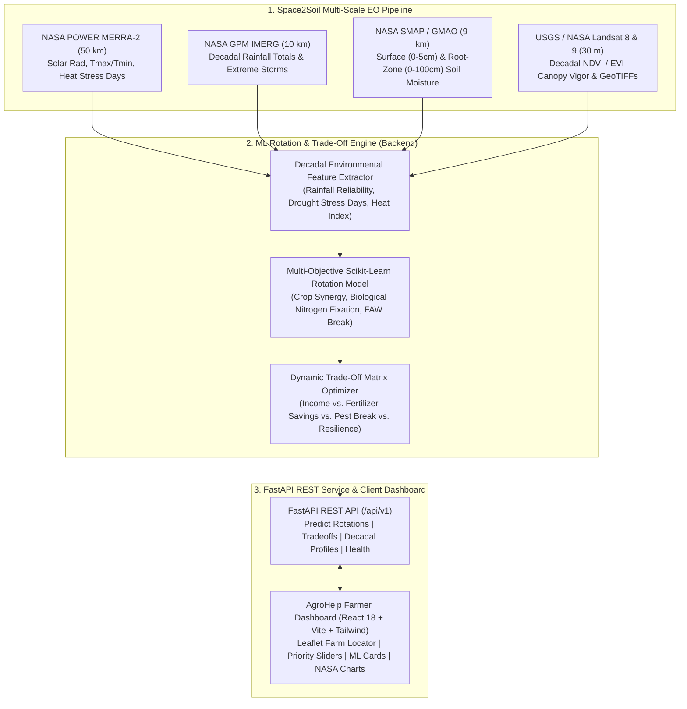

# AgroHelp: Field Shift — Adapting Smallholder Farms with NASA Earth Observation & ML

[](https://www.spaceappschallenge.org/)
[]()
[](https://mofa.gov.gh/site/directorates/55-district-directorates/district-ashanti/164-ejura-sekyeredumase)
[]()

> **AgroHelp** bridges multi-sensor NASA Earth observation datasets and machine learning to liberate smallholder farmers from high-risk, input-heavy monoculture into climate-resilient, pest-disruptive, and financially optimized crop rotations.

---

## Table of Contents
1. [The Smallholder Challenge in Ejura-Sekyedumase](#1-the-smallholder-challenge-in-ejura-sekyedumase)
2. [End-to-End System Architecture](#2-end-to-end-system-architecture)
3. [Space2Soil: Decadal Earth Observation Data Pipeline](#3-space2soil-decadal-earth-observation-data-pipeline)
4. [ML-Driven Crop Rotation & Trade-Off Engine](#4-ml-driven-crop-rotation--trade-off-engine)
5. [AgroHelp Farmer Dashboard (Frontend)](#5-agrohelp-farmer-dashboard-frontend)
6. [FastAPI Agricultural Intelligence Backend](#6-fastapi-agricultural-intelligence-backend)
7. [Repository Structure](#7-repository-structure)
8. [Quickstart & Installation](#8-quickstart--installation)
9. [Verification & Testing](#9-verification--testing)
10. [NASA Data Attribution & Citations](#10-nasa-data-attribution--citations)

---

## 1. The Smallholder Challenge in Ejura-Sekyedumase

**Ejura-Sekyedumase** (`7.3856° N, -1.3562° W`), situated in the forest-savannah transition zone of Ghana's Ashanti Region, is recognized as the nation's premier grain basket and primary maize aggregation hub. Despite its agricultural centrality, smallholders face escalating ecological and economic shocks:

* **88% Rain-Fed Maize Monoculture:** Farms are trapped in repeated maize cycles, depleting natural soil nitrogen, stripping organic matter, and creating extreme dependency on expensive synthetic fertilizers.
* **Fall Armyworm (*Spodoptera frugiperda*) Outbreaks:** Continuous cereal monocropping provides an uninterrupted food host for Fall Armyworm larvae, causing up to 45% yield destruction or catastrophic pesticide expenditures.
* **Shifting Monsoon Dynamics (2016–2025 Baseline):**
  * *Major Season (March–July):* Increasingly volatile onset, false planting rains, and terminal dry spells coinciding with critical maize flowering and silking stages.
  * *Minor Season (September–November):* Abrupt, erratic termination as the arid northeastern Harmattan dry winds surge early, desiccating unripened crops.
* **Capital Scarcity:** Farmers cannot absorb total crop loss, making agronomic trade-offs (e.g., immediate harvest cash vs. long-term soil carbon vs. input cost reduction) paramount.

**AgroHelp** transforms multi-decadal satellite telemetry from NASA POWER, GPM, SMAP, and Landsat into field-level rotation pathways that break pest cycles, replenish soil biology, and buffer against drought.

---

## 2. End-to-End System Architecture

AgroHelp operates as a unified three-tier agricultural intelligence system:



---

## 3. Space2Soil: Decadal Earth Observation Data Pipeline

The **Space2Soil** data engineering pipeline continuously processes and validates 10 years (2016–2025; 3,653 consecutive days) of satellite telemetry for Ejura:

| Scale | Sensor / Mission | Spatial Resolution | Key Parameters Extracted | Agronomic Role |
| :--- | :--- | :--- | :--- | :--- |
| **Macro** | **NASA POWER (MERRA-2)** | $0.5^\circ \times 0.625^\circ$ (~50 km) | $T_{\text{max}}, T_{\text{min}}, RH2M, ALLSKY\_SFC\_SW\_DWN$ | Thermal stress days ($T_{\text{max}} \ge 35^\circ\text{C}$), Diurnal Range |
| **Meso** | **NASA GPM IMERG Final Run** | $0.1^\circ \times 0.1^\circ$ (~10 km) | Daily precipitation, rolling 7d/30d sums, CV | Monsoon onset, dry spells, waterlogging risk |
| **Meso** | **NASA SMAP / GMAO L4** | $9\text{ km}$ grid | Surface ($0–5\text{ cm}$) & Root-Zone ($0–100\text{ cm}$) wetness | Germination success, wilting point, drought anomalies |
| **Micro** | **USGS/NASA Landsat 8 & 9 C2L2**| $30\text{ meters}$ | Decadal NDVI, EVI, cloud-cleared QA mask | Parcel vegetation baseline, biomass accumulation |

### Decadal Findings in Ejura:
* **Total Precipitation:** 14,088.6 mm across 10 years (mean $1,408.86\text{ mm/year}$).
* **Heavy & Torrential Events:** 64 heavy rain days ($\ge 25\text{ mm}$) and 17 extreme torrential days ($\ge 50\text{ mm}$, peak $135.07\text{ mm/day}$).
* **Root-Zone Drought Stress:** 557 agricultural drought stress days ($Z \le -1.0$) cataloged in SMAP data.
* **Crop Canopy Cycles:** Landsat NDVI ranges from $0.28$ during the Harmattan dry season to $0.74$ during the major maize vegetative peak.

---

## 4. ML-Driven Crop Rotation & Trade-Off Engine

Instead of static, rule-based recommendations, AgroHelp deploys a machine-learning scoring and trade-off engine (`backend/app/ml/engine.py`):

1. **Environmental Feature Ingestion:** Incorporates the farm's soil moisture anomaly ($Z$-score), decadal rainfall coefficient of variation ($CV$), and seasonal heat stress probability.
2. **Dynamic Weighting Vector:** Adapts to individual farmer priorities through 4 real-time weights:
   $$\vec{W} = [w_{\text{income}}, w_{\text{fert\_save}}, w_{\text{faw\_break}}, w_{\text{drought\_resil}}], \quad \sum w_i = 1.0$$
3. **Biological & Economic Crop Scoring:**
   * **Cereals (Cash Base):** Maize (*Zea mays*), Upland Rice (*Oryza sativa*). High cash demand, high nitrogen consumption, vulnerable to FAW.
   * **Legumes (Nitrogen Fixers):** Cowpea (*Vigna unguiculata*), Groundnut (*Arachis hypogaea*). Symbiotic rhizobial fixation ($40\text{--}80\text{ kg N/ha}$ credit), 100% Fall Armyworm non-host cycle break.
   * **Tubers (Soil Aeration):** Yam (*Dioscorea rotundata*), Cassava (*Manihot esculenta*). Deep taproot aeration, extreme drought tolerance, resilient harvest flexibility.
   * **Cover & Green Manure:** Pigeon Pea (*Cajanus cajan*), Mucuna. Soil armor, organic matter restitution.
4. **Scikit-Learn Model Fallback & Hot-Reloading:** Includes a robust ensemble predictor out-of-the-box, with dynamic loading support for external `joblib`/`pkl` models trained by the data science team.

---

## 5. AgroHelp Farmer Dashboard (Frontend)

Built with **React 18**, **Vite**, **Tailwind CSS**, **Lucide Icons**, and **Leaflet**:

* **Geographic Field Locator:** Interactive Leaflet map centered on Ejura-Sekyedumase (`7.3856, -1.3562`) allowing smallholders and extension agents to drop farm parcel pins and load local microclimatic data.
* **Reactive Farmer Priority Sliders:** Live controls for balancing immediate market income, fertilizer cost savings, pest interruption, and drought protection.
* **ML Rotation Prediction Cards:** Dynamic cards displaying ranked multi-season crop sequences, overall suitability scores, estimated fertilizer reductions (%), FAW cycle break index, and agronomic management instructions.
* **Trade-Off Visual Explorer:** Multi-axis comparison of selected rotation scenarios showing explicit trade-offs between cash flow and soil conservation.
* **NASA Space2Soil Indicators:** Live telemetry badges displaying decadal rainfall variability, root-zone drought anomalies, and temperature stress probabilities.

---

## 6. FastAPI Agricultural Intelligence Backend

The backend provides high-performance, asynchronous REST endpoints:

* `GET /api/v1/health` — System status, Space2Soil data pipeline verification, and ML model readiness.
* `POST /api/v1/predict-rotations` — Accepts farm characteristics and priority weights, returning dynamic ML-ranked crop rotation sequences.
* `POST /api/v1/tradeoffs` — Computes comparative trade-off matrices between monoculture and regenerative rotation pathways.
* `GET /api/v1/environmental-profile` — Returns decadal NASA POWER, GPM, SMAP, and Landsat statistical baselines for Ejura.
* `GET /api/v1/pilot-data` — Serves local agro-ecological profiles, dominant crop benchmarks, and Extension Ministry (MOFA) recommendations.

---

## 7. Repository Structure

```text
AgroHelp/
├── .env.example                         <- Template environment configuration
├── .gitignore                           <- Root ignore rules (Python, Node, cache, OS)
├── README.md                            <- Comprehensive platform documentation
│
├── backend/                             <- FastAPI ML intelligence service
│   ├── app/
│   │   ├── main.py                      <- FastAPI application entrypoint & CORS setup
│   │   ├── api/
│   │   │   ├── endpoints.py             <- REST API routing & controller logic
│   │   │   └── models.py                <- Pydantic validation schemas
│   │   ├── ml/
│   │   │   ├── engine.py                <- Scikit-Learn rotation & tradeoff engine
│   │   │   └── crop_data.py             <- Crop agronomic & biological traits catalog
│   │   └── services/
│   │       └── space2soil_loader.py     <- Decadal NASA dataset ingestion service
│   ├── tests/
│   │   ├── test_api.py                  <- FastAPI endpoint test suites
│   │   └── test_ml_engine.py            <- Machine learning engine verification tests
│   └── requirements.txt                 <- Backend Python dependencies (FastAPI, uvicorn, scikit-learn, etc.)
│
├── frontend/                            <- AgroHelp React/Vite dashboard
│   ├── src/
│   │   ├── components/                  <- Map, priority sliders, ML cards, trade-off charts
│   │   ├── services/
│   │   │   └── api.js                   <- Robust client API client with resilient fallbacks
│   │   ├── App.jsx                      <- Main application layout & state coordinator
│   │   └── index.css                    <- Tailwind styling & custom components
│   ├── package.json                     <- Frontend dependencies & build scripts
│   └── vite.config.js                   <- Vite build configuration
│
├── Space2Soil/                          <- Data engineering & NASA Earth observation pipeline
│   ├── data/
│   │   └── processed/                   <- 10-Year clean NASA POWER, GPM, SMAP, Landsat series
│   ├── notebooks/
│   │   └── space2soil_data_exploration.ipynb <- Decadal data exploration notebook
│   ├── src/                             <- Acquisition, preprocessing, and validation routines
│   ├── DATA_DICTIONARY.md               <- Full satellite parameter dictionary
│   ├── DATA_SOURCES.md                  <- NASA mission telemetry specs
│   └── VALIDATION_REPORT.md             <- Decadal validation findings & bounds checks
│
└── Info/
    ├── Location info.md                 <- Ministry of Food & Agriculture (MOFA) Ejura field notes
    └── Space2Soil_Project_Roadmap.docx  <- Project vision and team milestones
```

---

## 8. Quickstart & Installation

### Prerequisites
* **Python 3.10+**
* **Node.js 18+ & npm**

### 1. Clone & Configure Environment
```bash
git clone https://github.com/your-org/AgroHelp.git
cd AgroHelp
cp .env.example .env
```

### 2. Launch the Backend API
```bash
cd backend
python -m venv .venv

# On Linux/macOS:
source .venv/bin/activate
# On Windows:
.venv\Scripts\activate

pip install -r requirements.txt
uvicorn app.main:app --host 0.0.0.0 --port 8000 --reload
```
* Interactive API Documentation: [http://localhost:8000/docs](http://localhost:8000/docs)
* Health Check: [http://localhost:8000/api/v1/health](http://localhost:8000/api/v1/health)

### 3. Launch the Frontend Dashboard
```bash
cd frontend
npm install
npm run dev
```
* Dashboard URL: [http://localhost:5173](http://localhost:5173)

---

## 9. Verification & Testing

### Running Backend Tests
Execute the comprehensive Pytest suite covering ML rotation logic, NASA data loading, and API endpoints:
```bash
cd backend
pytest -v
```

### Running Frontend Production Build
Verify static asset optimization and zero build errors:
```bash
cd frontend
npm run build
```

---

## 10. NASA Data Attribution & Citations

* **NASA POWER Project:** NASA Langley Research Center (LaRC) supported by the NASA Earth Science Applied Sciences Program.
* **NASA GPM IMERG:** Goddard Earth Sciences Data and Information Services Center (GES DISC) and the NASA Precipitation Processing System.
* **NASA SMAP:** NASA Jet Propulsion Laboratory (JPL) and Goddard Space Flight Center (GSFC), distributed by the National Snow and Ice Data Center (NSIDC) DAAC.
* **USGS/NASA Landsat Program:** U.S. Geological Survey Earth Resources Observation and Science (EROS) Center & Microsoft Planetary Computer STAC.
* **Local Agro-Ecological Data:** Ministry of Food and Agriculture (MOFA), Ejura-Sekyedumase District Directorate, Ashanti Region, Ghana.
