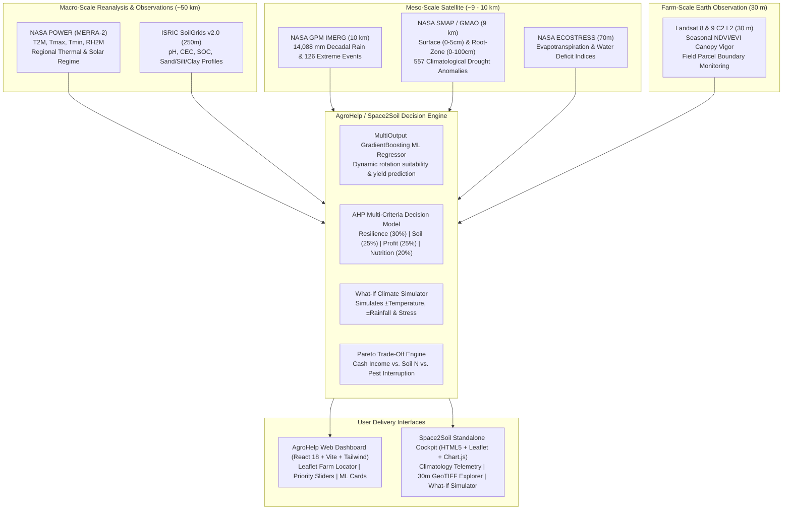

# AgroHelp / Space2Soil: Field Shift — Adapting Farms with NASA Earth Observation Data & ML

[](https://www.spaceappschallenge.org/)
[]()
[]()
[-0284C7.svg)]()
[-success.svg)]()
[]()

> **AgroHelp** (developed by team **Space2Soil**) bridges multi-sensor NASA Earth observation datasets and machine learning to liberate smallholder farmers from high-risk, input-heavy monoculture into climate-resilient, pest-disruptive, and financially optimized crop rotations.

---

## 1. Agricultural Problem & Motivation (Ejura-Sekyedumase, Ghana)

**Ejura-Sekyedumase** (`7.3856° N, -1.3562° W`), situated in the forest-savannah transition zone of Ghana's Ashanti Region, is recognized as the nation's premier grain basket and primary maize aggregation hub. Despite its agricultural centrality, smallholder farmers face severe compounding shocks:

* **The Maize Monoculture Trap:** Over **88% of cultivated acreage** is locked in rain-fed, continuous maize monoculture dependent on escalating synthetic fertilizers (NPK 15:15:15, Urea).
* **Fall Armyworm (*Spodoptera frugiperda*) Invasions:** Continuous cereal cropping provides an unbroken host canopy across seasons, causing recurring yield losses of 30–60%.
* **Rainfall Volatility & Harmattan Onset:** The bimodal monsoon is increasingly volatile—the **major season (Apr–Jul)** faces erratic starts, while the **minor season (Sep–Nov)** is cut short by abrupt transitions into the hyper-arid, dusty Harmattan wind regime.
* **Severe Soil Erosion & Degradation:** High rainfall erosivity ($MFI = 143.2$) combined with bare ground between cycles rapidly strips fertile topsoil.

**AgroHelp** transforms multi-decadal satellite telemetry from NASA POWER, GPM, SMAP, ECOSTRESS, and Landsat into field-level rotation pathways that break pest cycles, replenish soil biology, and buffer against drought.

---

## 2. Integrated NASA Earth Observation Architecture



---

## 3. Project Roadmap & Implementation Matrix

| Phase | Milestone Name | Key Technical Deliverables | Status |
| :---: | :--- | :--- | :---: |
| **Phase 1** | **Research & Problem Definition** | Target site selection (Ejura, Ghana), MOFA baseline data, scale disclaimer. | **Completed** |
| **Phase 2** | **Data Acquisition & Preprocessing** | 10-Year Decadal NASA records (POWER, GPM, SMAP, Landsat), 30 m GeoTIFFs, validation reports. | **Completed** |
| **Phase 3** | **Scientific Analysis & Indicators** | Bimodal onset/cessation, GDD, RAW soil balance, MFI erosivity ($143.2$), crop suitability matrix. | **Completed** |
| **Phase 4** | **Recommendation Engine & Models** | MultiOutput ML regressor, AHP multi-criteria scoring, 3 rotation scenarios, XAI advisory cards. | **Completed** |
| **Phase 5** | **Application Development** | Modern React+Vite farmer dashboard (`frontend/`), FastAPI REST service (`backend/`), and standalone cockpit with What-If Climate Simulator (`Space2Soil/web/`). | **Completed** |
| **Phase 6** | **Testing & Competition Pitch** | 30/30 automated tests passing (17 backend pytest + 13 Space2Soil end-to-end), NASA ECOSTRESS ET, ISRIC SoilGrids v2.0, 3-minute video pitch deck (`PRESENTATION.md`). | **Completed** |

---

## 4. Repository Structure

```text
AgroHelp/
├── README.md                           <- Master repository guide & architecture
├── ARCHITECTURE.md                     <- Detailed architectural blueprint & data flow diagrams
├── .gitignore                          <- Comprehensive ignore rules (Python, Node, .venv)
├── .env.example                        <- Environment configuration template
│
├── Info/                               <- Project blueprints & MOFA district context
│   ├── Location info.md                <- Official Ghana MOFA data for Ejura-Sekyedumase
│   └── Space2Soil_Project_Roadmap.docx <- Hackathon strategic roadmap & judging alignment
│
├── docs/                               <- Centralized Knowledge Base & Technical Documentation
│   ├── README.md                       <- Master documentation index
│   ├── 01_mofa_ejura_context.md        <- Ministry of Food & Agriculture local reality
│   ├── 02_nasa_earth_observation.md    <- Satellite specifications & scale caveats
│   ├── 03_scientific_methodology.md    <- Agro-meteorological models & mathematical formulas
│   ├── 04_ml_recommendation_engine.md  <- ML model architecture & tradeoff calculations
│   ├── 05_api_reference.md            <- REST endpoint contracts & payload schemas
│   └── 06_competition_pitch_guide.md   <- 3-minute challenge pitch script & slides
│
├── scripts/                            <- 1-Click Developer Productivity Suite
│   ├── dev-backend.bat / .ps1          <- Launch FastAPI backend server (Port 8000)
│   ├── dev-frontend.bat / .ps1         <- Launch React Vite dashboard (Port 5173)
│   ├── dev-space2soil.bat / .ps1       <- Launch Space2Soil standalone cockpit (Port 8501)
│   └── run-all-tests.ps1               <- Run all 30 automated tests across subsystems
│
├── Space2Soil/                         <- Team Data Science, Earth Observation Pipeline & Standalone Cockpit
│   ├── app.py                          <- Zero-dependency HTTP server & REST gateway
│   ├── requirements.txt                <- Data science & geospatial dependencies
│   ├── DATA_DICTIONARY.md              <- Comprehensive parameter dictionary (now with SoilGrids & ECOSTRESS)
│   ├── DATA_SOURCES.md                 <- NASA mission specs & spatial scale caveats
│   ├── VALIDATION_REPORT.md            <- Complete decadal validation findings (3,653 days)
│   ├── SCIENTIFIC_METHODOLOGY.md       <- Agro-meteorological models & mathematical formulas
│   ├── RECOMMENDATION_SYSTEM.md        <- Decision engine & scenario tradeoffs
│   ├── TESTING_REPORT.md               <- Phase 6 automated test suite results (13/13 PASS)
│   ├── PRESENTATION.md                 <- Competition pitch deck & 3-minute video script
│   ├── web/                            <- Standalone cockpit with What-If Climate Simulator
│   ├── data/
│   │   ├── raw/                        <- NASA POWER, GPM, SMAP, Landsat, ECOSTRESS, SoilGrids raw
│   │   ├── processed/                  <- Clean daily, monthly, and derived indicators
│   │   └── metadata/                   <- JSON validation reports & engine schemas
│   ├── notebooks/                      <- Exploratory data analysis & model notebooks
│   └── src/                            <- Acquisition, preprocessing, validation, analysis & recommendation
│
├── backend/                            <- AgroHelp FastAPI Backend & ML Model Engine
│   ├── app/
│   │   ├── main.py                     <- FastAPI application entrypoint with CORS
│   │   ├── core/data_loader.py         <- Ingests 10-year decadal Space2Soil datasets
│   │   ├── ml/engine.py                <- Dynamic ML predictor & Pareto trade-off engine
│   │   ├── ml/crop_knowledge.py        <- MOFA agronomic rules & biological coefficients
│   │   ├── ml/model_loader.py          <- Pluggable loader for teammate .joblib/.pkl models
│   │   └── api/routes.py               <- Endpoints: /predict-rotations, /tradeoffs, /pilot-data
│   ├── tests/                          <- Pytest test suite (17/17 PASS)
│   └── requirements.txt                <- FastAPI, uvicorn, pydantic, scikit-learn, httpx
│
└── frontend/                           <- AgroHelp Farmer Web Dashboard (React 18 + Vite)
    ├── src/
    │   ├── components/FarmMap.jsx      <- Interactive Leaflet map (Ejura community selector)
    │   ├── components/FarmProfileControls.jsx <- Priority sliders (Income, Fertilizer, FAW, Drought)
    │   ├── components/MLPredictionCards.jsx   <- Dynamic ML crop rotation recommendations
    │   ├── components/TradeoffExplorer.jsx    <- Multi-dimensional trade-off comparisons
    │   └── components/NasaIndicatorsDashboard.jsx <- Decadal NASA climate & soil telemetry
    └── package.json                    <- React 18, Vite, Tailwind CSS, Leaflet, Lucide
```

---

## 5. Crop Rotation Recommendation Decision Engine

Evaluates crop sequences against 4 core dimensions: Climate Resilience (30%), Soil Health & Nitrogen (25%), Economic Profitability (25%), and Nutritional Diversity (20%):

| Scenario | Cropping Sequence | Composite Score | Net Profit (GHS/ha) | Net Soil Nitrogen | Ground Cover | Verdict |
| :--- | :--- | :---: | :---: | :---: | :---: | :--- |
| **Scenario 1** | Drought Maize + Relay Cassava $\rightarrow$ Cowpea | **97.1** (Rank 1) | **GHS 23,652** ($1,577) | **+15.0 kg N/ha** | 10.0 mo | **Top Resilience Pick (WINNER)** |
| **Scenario 2** | White Yam + Border Maize $\rightarrow$ Soybean | **89.1** (Rank 2) | **GHS 35,730** ($2,382) | 0.0 kg N/ha | 9.0 mo | **High Commercial Profit** |
| **Baseline** | Conventional Maize Monoculture | **51.2** (Rank 3) | GHS 7,000 ($467) | -75.0 kg N/ha | 4.5 mo | High Climate Vulnerability |

---

## 6. Running the Applications

### Option A: AgroHelp Full-Stack Platform (FastAPI + React Vite)

#### 1. Start Backend API (FastAPI)
```bash
cd backend
python -m uvicorn app.main:app --reload --port 8000
```
*API Documentation & Swagger:* [http://localhost:8000/docs](http://localhost:8000/docs)

#### 2. Start Frontend Dashboard (React + Vite)
```bash
cd frontend
npm install
npm run dev
```
*Web Dashboard:* [http://localhost:5173](http://localhost:5173)

---

### Option B: Space2Soil Standalone Cockpit (Zero-Dependency)

```bash
cd Space2Soil
python app.py --open
```
*Opens your browser at `http://127.0.0.1:8501`, featuring the What-If Climate Simulator and 30m NDVI overlays.*

---

## 7. Running the Automated Test Suites (30/30 Tests PASS)

### 1. Space2Soil End-to-End System Tests (13 Tests)
```bash
cd Space2Soil
python src/validation/test_end_to_end.py
```
*Result: 13/13 passed (NASA POWER, GPM, SMAP, Landsat, SoilGrids, ECOSTRESS, What-If simulator).*

### 2. AgroHelp Backend ML & REST API Suite (17 Tests)
```bash
python -m pytest backend/tests -v
```
*Result: 17/17 passed (data loader, ML predictor, priority sensitivity, Pareto trade-offs, and REST endpoints).*

---

## 8. Presentation & Pitch Resources
- **Pitch Deck & Video Script:** Available at [`Space2Soil/PRESENTATION.md`](file:///Space2Soil/PRESENTATION.md) (covers the 3-minute challenge presentation and slide breakdown).
- **Ghana MOFA Baseline:** Detailed in [`docs/01_mofa_ejura_context.md`](file:///docs/01_mofa_ejura_context.md).

---

## 9. Citation & NASA Attribution
- **NASA POWER Project:** NASA Langley Research Center (LaRC).
- **NASA GPM IMERG:** Goddard Earth Sciences Data and Information Services Center (GES DISC).
- **NASA SMAP:** National Snow and Ice Data Center (NSIDC) DAAC.
- **NASA ECOSTRESS:** NASA Jet Propulsion Laboratory (JPL).
- **ISRIC World Soil Information:** SoilGrids v2.0 Global Gridded Soil Information.
- **USGS / NASA Landsat:** USGS EROS Center / Microsoft Planetary Computer STAC.
