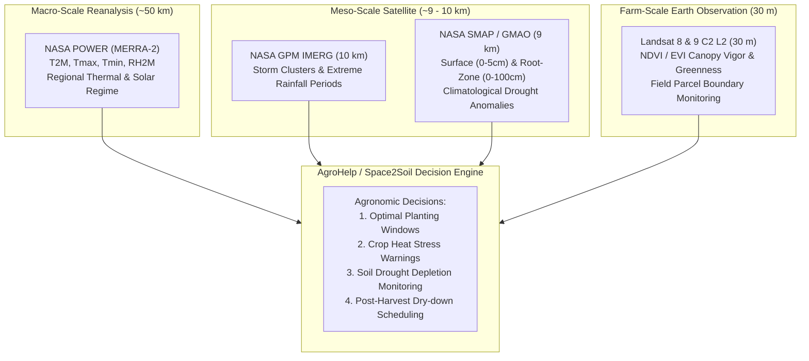

# AgroHelp: Field Shift — Adapting Farms with NASA Earth Observation Data

**Space Apps Challenge Track:** Field Shift: Adapting Farms with NASA Data  
**Core Project Engine:** Space2Soil  
**Pilot Study Region:** Ejura, Ashanti Region, Ghana (`7.3856° N, -1.3562° W`)  
**Historical Climatological Baseline:** 2016 – 2025 (10-Year Decadal Dataset, 3,653 Days)  

---

## 1. Overview & Agricultural Motivation

**AgroHelp / Space2Soil** is a geospatial data engineering and agricultural intelligence platform designed to empower smallholder farmers, extension officers, and agricultural policymakers in Ghana to adapt to accelerating climate variability. 

Ejura, located within the forest-savannah transition zone of the Ashanti Region, serves as Ghana's primary breadbasket and maize grain hub. However, shifts in the West African Monsoon have destabilized the traditional bimodal cropping seasons:
- **Major Cropping Season (March/April – July):** Vulnerable to delayed onset, false planting starts, and mid-season heat stress during maize flowering.
- **Minor Cropping Season (September – November):** Subject to erratic rainfall termination and abrupt transitions into the dry Harmattan season.

By acquiring, validating, and preprocessing multi-sensor NASA Earth observation datasets across **four distinct spatial scales**, AgroHelp transforms raw satellite observations into actionable agronomic guidance.

---

## 2. Integrated NASA Earth Observation Architecture



---

## 3. Repository Structure

```text
AgroHelp/
├── README.md                           <- Repository overview & architectural guide
├── .gitignore                          <- Python, virtual environment & OS ignores
├── Space2Soil/
│   ├── requirements.txt                <- Python dependencies
│   ├── DATA_DICTIONARY.md              <- Comprehensive parameter dictionary
│   ├── DATA_SOURCES.md                 <- NASA mission specs & spatial scale caveats
│   ├── VALIDATION_REPORT.md            <- Complete decadal validation findings
│   ├── data/
│   │   ├── raw/
│   │   │   ├── nasa_power/             <- Daily raw agroclimatology (JSON & CSV)
│   │   │   ├── gpm/                    <- Daily GPM IMERG rainfall & granule catalog
│   │   │   ├── smap/                   <- Daily surface & root-zone soil wetness
│   │   │   └── landsat/                <- 454 Decadal Landsat STAC scene catalog
│   │   ├── processed/
│   │   │   ├── climate/                <- Clean daily & monthly climate series
│   │   │   ├── rainfall/               <- Clean daily, monthly & extreme event series
│   │   │   ├── soil_moisture/          <- Clean daily, monthly & drought anomaly series
│   │   │   └── vegetation/             <- Decadal NDVI/EVI time series & 30m GeoTIFFs
│   │   └── metadata/                   <- JSON schemas & pipeline validation logs
│   ├── notebooks/
│   │   └── space2soil_data_exploration.ipynb  <- Interactive exploratory analysis
│   ├── src/
│   │   ├── acquisition/                <- Production NASA data acquisition scripts
│   │   ├── preprocessing/              <- Cleaning, aggregation & anomaly routines
│   │   └── validation/                 <- Physical integrity & bounds validators
│   └── logs/                           <- Verification and execution run logs
```

---

## 4. Key Datasets & Agricultural Indices

### 4.1 NASA POWER Agroclimatology (`0.5° × 0.625°`, ~50 km)
- **Parameters:** `PRECTOTCORR` (Precipitation), `T2M` (Mean Temp), `T2M_MAX` (Max Temp), `T2M_MIN` (Min Temp), `RH2M` (Relative Humidity).
- **Derived Metrics:** Diurnal Temperature Range ($DTR$), Heat Stress Days ($T_{\max} \ge 35^\circ C$).
- **Status:** **3,653 days (2016–2025, 100% complete).**

### 4.2 NASA GPM IMERG Precipitation (`0.1° × 0.1°`, ~10 km)
- **Parameters:** Daily precipitation, monthly totals, rainfall variability ($CV = 1.91$), rolling 7-day and 30-day cumulative precipitation.
- **Decadal Total Rainfall:** **14,088.6 mm** (Annual average: **1,408.86 mm/year**).
- **Extremes:** 64 heavy rain days ($\ge 25\text{ mm}$), 17 extreme torrential days ($\ge 50\text{ mm}$, peak $135.07\text{ mm/day}$), and 126 flood/waterlogging risk periods cataloged.

### 4.3 NASA SMAP / GMAO Soil Moisture (`9 km` grid)
- **Depths:**
  - **Surface Layer ($0–5\text{ cm}$):** Mean wetness fraction $0.597$ ($\theta = 0.257\text{ m}^3/\text{m}^3$). Informs seed germination and crusting.
  - **Root-Zone Profile ($0–100\text{ cm}$):** Mean wetness fraction $0.590$ ($\theta = 0.254\text{ m}^3/\text{m}^3$). Drives crop transpiration and drought onset.
- **Anomalies:** Standardized Day-of-Year $Z$-scores identified **557 agricultural drought stress days** ($Z \le -1.0$).

### 4.4 USGS/NASA Landsat 8 & 9 Collection 2 Level-2 (`30 meters`)
- **Coverage:** 454 decadal scenes cataloged across WRS Path 194, Row 54; 115 clear scenes ($\le 20\%$ cloud cover).
- **Indices:** Normalized Difference Vegetation Index (NDVI) and Enhanced Vegetation Index (EVI) cloud-masked via USGS QA_PIXEL 16-bit bitmask.
- **Analysis-Ready GeoTIFFs (30 m):**
  - `ejura_ndvi_dry_season_harmattan.tif` (Senescent baseline, mean NDVI $\sim 0.28$)
  - `ejura_ndvi_major_rainy_season_peak.tif` (Peak canopy biomass, mean NDVI $\sim 0.74$)
  - `ejura_ndvi_minor_rainy_season_peak.tif` (Second cropping cycle, mean NDVI $\sim 0.66$)

---

## 5. Quickstart & Installation

### Requirements
- Python 3.10+
- Dependencies listed in `Space2Soil/requirements.txt`:
  ```bash
  pip install -r Space2Soil/requirements.txt
  ```

### Running the Exploration Notebook
To interactively explore the 10-year decadal climatology, soil moisture drawdown, and vegetation dynamics:
```bash
jupyter notebook Space2Soil/notebooks/space2soil_data_exploration.ipynb
```

---

## 6. Citation & NASA Attribution
- NASA POWER Project: NASA Langley Research Center (LaRC).
- NASA GPM IMERG: Goddard Earth Sciences Data and Information Services Center (GES DISC).
- NASA SMAP: National Snow and Ice Data Center (NSIDC) DAAC.
- USGS/NASA Landsat: USGS EROS Center / Microsoft Planetary Computer STAC.

