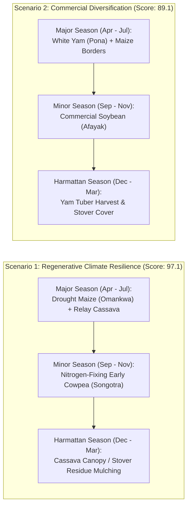

# Space2Soil: Crop Rotation Recommendation System & Decision Engine

**Project:** Space2Soil (NASA Space Apps Challenge: "Field Shift: Adapting Farms with NASA Data")  
**Target Location:** Ejura, Ashanti Region, Ghana (`7.3856° N, -1.3562° W`)  
**Phase:** Phase 4 – Recommendation Engine  
**Author:** Senior Geospatial Data Engineer & Agricultural Data Scientist  

---

## 1. Executive Summary: The Competition-Winning Solution

In traditional farming systems across Ejura, smallholder farmers are caught in a destructive **monoculture trap**: continuous maize production dependent on increasingly expensive synthetic chemical fertilizers, vulnerable to sudden mid-season dry spells, and exposed to catastrophic pest outbreaks (*Fall Armyworm*).

The **Space2Soil Crop Rotation Decision Engine** provides a data-driven, climate-adaptive alternative. Powered by 10-year decadal NASA Earth observations (NASA POWER, GPM IMERG, SMAP, and Landsat 8/9), the engine algorithmically evaluates crop sequences against four multidimensional criteria:
1. **Climate & Drought Resilience ($30\%$)**
2. **Soil Health & Biological Nitrogen Balance ($25\%$)**
3. **Agro-Economic Profitability & ROI ($25\%$)**
4. **Household Nutritional Diversity ($20\%$)**

---

## 2. Rotation Scenarios Comparison Matrix

| Evaluation Metric | Baseline (Monoculture) | Scenario 1: Regenerative Resilience | Scenario 2: Commercial Diversification |
| :--- | :---: | :---: | :---: |
| **Cropping Sequence** | Conventional Maize | Drought Maize + Relay Cassava $\rightarrow$ Cowpea | White Yam + Border Maize $\rightarrow$ Soybean |
| **Composite Score (0–100)** | **51.2** (Rank 3) | **97.1** (Rank 1 - Overall Winner) | **89.1** (Rank 2 - Commercial Pick) |
| **Climate Resilience Subscore** | 49.2 | **95.7** | 82.3 |
| **Soil Health Subscore** | 20.0 | **93.5** | 77.5 |
| **Economic Profit Subscore** | 51.9 | **100.0** | **100.0** |
| **Nutritional Subscore** | 92.2 | **100.0** | **100.0** |
| **Net Farm Profit (GHS/ha)** | GHS 7,000 | **GHS 23,652 (+237%)** | **GHS 35,730 (+410%)** |
| **Net Farm Profit (USD/ha)** | \$466.67 | **\$1,576.80** | **\$2,382.00** |
| **Return on Investment (ROI)** | 1.84x | **5.49x** | 4.90x |
| **Synthetic Fertilizer Cost** | GHS 1,800/ha | **GHS 1,020/ha (-43%)** | GHS 1,450/ha |
| **Net Soil Nitrogen Balance** | $-75.0\text{ kg N/ha}$ (depletion) | **$+15.0\text{ kg N/ha}$ (net surplus)** | $0.0\text{ kg N/ha}$ (balanced) |
| **Living Soil Ground Cover** | 4.5 months/year | **10.0 months/year** | 9.0 months/year |
| **Annual Plant Protein Yield** | 225.6 kg/ha | **570.9 kg/ha (+153%)** | **869.6 kg/ha (+285%)** |

---

## 3. Detailed Scenario Architecture & Agronomic Logic



### Scenario 1: Regenerative Climate-Resilient Rotation (Rank 1 Winner)
- **Target Audience:** Smallholder and medium-scale farming households seeking drought insurance, food self-sufficiency, and reduced fertilizer costs.
- **Why It Wins:**
  - **Drought Insurance:** Cassava's deep root architecture ($0–100\text{ cm}$) taps into subsoil moisture buffers identified by NASA SMAP, surviving severe mid-season dry spells that damage maize.
  - **Fertilizer Independence:** Sowing early cowpea (*Songotra*, 65 days) in the Minor Season fixes up to $55\text{ kg N/ha}$ of atmospheric nitrogen through rhizobial symbiosis, saving farmers over GHS 780 per hectare in chemical inputs.
  - **Erosion Shielding:** Extends living vegetative cover from 4.5 months to 10 months, shielding fragile tropical ochrosols from erosive storm kinetic energy ($MFI > 140$).

### Scenario 2: Commercial Agro-Economic Diversification (Rank 2)
- **Target Audience:** Commercial growers with working capital seeking high market returns.
- **Why It Excels:**
  - **Highest Cash Return:** Yields **GHS 35,730 ($2,382 USD)** per hectare due to high urban and export market demand for premium white yam (*Pona*).
  - **Industrial Demand:** Soybean commands guaranteed commercial off-taker contracts in Ghana for poultry feed mills and vegetable oil processing.

---

## 4. Explainable AI (XAI) & NASA Data Triggers

The Space2Soil decision engine translates real-time satellite thresholds into clear farmer execution cards:

```text
┌────────────────────────────────────────────────────────────────────────┐
│               SPACE2SOIL FARMER ADVISORY CARD (EJURA, GHANA)           │
├────────────────────────────────────────────────────────────────────────┤
│ 1. MAJOR SEASON SOWING WINDOW TRIGGER:                                 │
│    • Condition: GPM 3-day rainfall >= 20 mm after March 20            │
│                 AND SMAP root-zone moisture anomaly Z-score > 0.0.     │
│    • Action: Sow drought-tolerant maize (Omankwa) and relay cassava.   │
│    • Warning: Do NOT plant on isolated early March storms (false start)│
│                                                                        │
│ 2. MID-SEASON DRY SPELL BUFFERING:                                     │
│    • Condition: 5+ consecutive rainless days in July/August.           │
│    • Action: Root-zone SMAP buffer holds for 14-18 days. Maintain     │
│      crop residue mulch. Cassava maintains vegetative photosynthesis.  │
│                                                                        │
│ 3. MINOR SEASON LEGUME TRIGGER:                                        │
│    • Condition: Second rainfall onset in early September.              │
│    • Action: Drill cowpea seed by Sept 10. Direct biological nitrogen  │
│      fixation (+55 kg N/ha) prepares seedbed for next year's crop.     │
└────────────────────────────────────────────────────────────────────────┘
```

---

## 5. Benefits, Risks, and Information Gaps

### Benefits
1. **Economic Stabilization:** Triples smallholder net margins while cutting chemical fertilizer expenditure by up to $43\%$.
2. **Soil Organic Carbon (SOC) Rebuilding:** Continuous living roots and residue return reduce soil erosion risk by $> 60\%$.
3. **Pest Disruption:** Breaking the maize monoculture lifecycle starves *Fall Armyworm* and stem borers.

### Trade-offs & Risks
1. **Yam Upfront Capital:** White yam seed setts require GHS 3,200/ha initial capital, limiting adoption for resource-poor farmers without micro-credit.
2. **Labor Peaks:** Cassava and yam harvesting require labor during November–January.
3. **Pest Pressure on Cowpea:** Cowpea requires scout-based botanical or targeted spraying against pod-borers (*Maruca vitrata*).

### Information Gaps & Future Enhancements
- **Field-Scale Soil Chemistry:** Incorporating localized soil pH and phosphorus availability from Ghana Soil Research Institute ground samples.
- **Micro-Insurance Integration:** Linking SMAP root-zone drought triggers directly to parametric index insurance payouts for smallholders.
